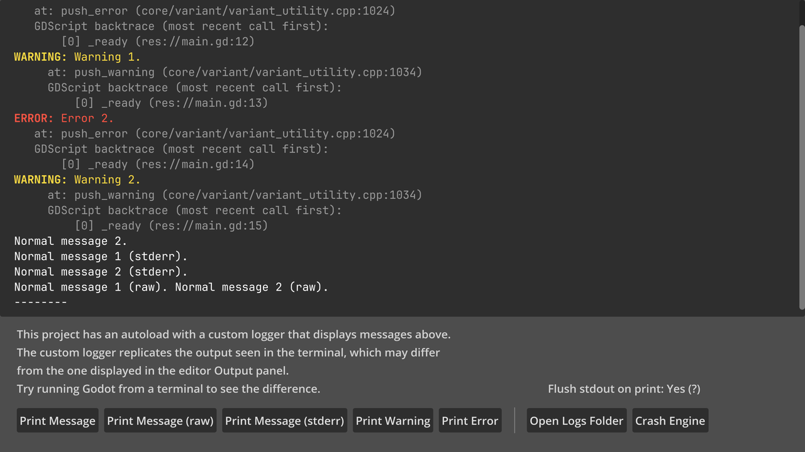
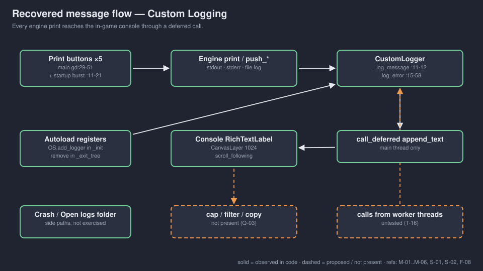
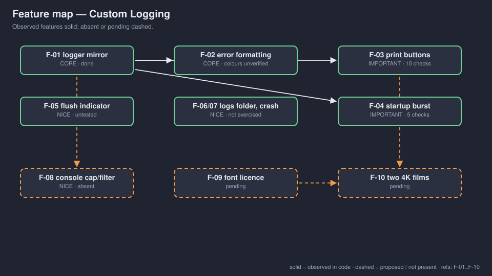

# walker-misc-custom-logging — Game Design Document (recovered)

| | |
|---|---|
| Version | 0.1.0-recovered |
| Date | 2026-09-27 |
| Author | Zelda (agent, silent) for Nik Bear Brown |
| Command | `/gdd reverse --path godot silent` |
| Mode | recovered |
| Revision | 1 |
| Gates | gate — unsigned at time of writing (vision ○ · systems ○ · world ○ · scope ○) |
| Source | local adaptation of Godot demo `misc/custom_logging`, upstream commit `a3b5c11` `[OBSERVED README.md:3-4]` |
| Verdict | **Tech demo, not a game.** An autoloaded custom `Logger` mirrors engine output into an in-game console; buttons generate messages. |

Provenance tags: `[OBSERVED path:line]` the code does this · `[INFERRED]` implied, evidence stated · `[MISSING]` the code cannot say; each is an open question in `decisions.md`. Code paths are relative to `godot/`. A recovered GDD describes what exists; it approves nothing. Image and diagram links are relative to `design/`; the root `GDD.md` is an identical copy, so open `design/GDD.md` or `design/DECK.html` to see the pictures.

*Upstream screenshot referenced by `godot/README.md:19`, retained from the source demo `[INFERRED: listed in the upstream README]`. Not a Walker capture; colours and layout are unverified in Walker `[OBSERVED FRICTIONAL.md]`.*

## 1. Vision summary

**What exists.** An autoload `CustomLoggerUI` (a `CanvasLayer` on layer 1024 with a `RichTextLabel`) registers a `Logger` subclass in `_init()` and appends every message and error the engine prints `[OBSERVED project.godot:22-24; custom_logger_ui.gd:10-65; custom_logger_ui.tscn:19-38]`. The main scene prints a fixed set of messages on start and offers seven buttons: five that print (message, raw, stderr, warning, error), one that opens the logs folder, one that crashes the engine `[OBSERVED main.gd:11-59; main.tscn:78-120]`.

**What it teaches.** How to write a thread-safe custom logger in Godot 4.7: override `_log_message` and `_log_error`, never touch nodes directly from the logger (use `call_deferred`), format error types, include script backtraces, and remove the logger on exit `[OBSERVED custom_logger_ui.gd:6-72 comments]`.

**Why it is in Walker / for whom.** `[MISSING → Q-01, Q-02]`. One plausible Walker use: an on-screen console for headless-verified games, where failures should be legible without a terminal `[INFERRED: every Walker folder in this batch leans on printed PASS/FAIL logs; nothing here says so]`.

**Player fantasy.** None; no player, goal or fail state. The "Crash Engine" button is a deliberate diagnostic, not a lose condition `[OBSERVED main.gd:58-59]`.

**Biggest unresolved question.** Is this a demo to film, or a utility Walker games should adopt (Q-01)? The answer decides whether thread-stress and file-flush behaviour must be verified (Q-04).

## 2. Design pillars

None stated `[MISSING → Q-01]`. Readings `[INFERRED]`:

| ID | Inferred pillar | Evidence |
|---|---|---|
| P-01 | The console shows what the terminal shows | label text in `main.tscn:41-44`; logger mirrors all prints |
| P-02 | Logger code is thread-safe | `call_deferred` + comment `custom_logger_ui.gd:6-12, 49` |
| P-03 | Register early, remove on exit | `_init` `:61-65`, `_exit_tree` `:68-72` |

## 3. Core loop

Press a print button → counter increments → engine print function → engine logger chain → `CustomLogger._log_message` / `_log_error` → deferred `append_text` on the console → console auto-scrolls `[OBSERVED main.gd:29-51; custom_logger_ui.gd:11-58; custom_logger_ui.tscn:37 scroll_following]`.

## 4. Player Experience Goals

`[MISSING → Q-02]` Candidate learner outcomes `[INFERRED]`:

| ID | Candidate outcome | Evidence |
|---|---|---|
| PX-01 | Tell print, printraw, printerr, push_warning and push_error apart by what they produce | one button per call `main.gd:29-51` |
| PX-02 | Explain why the logger defers UI updates | comment `custom_logger_ui.gd:6-9` |
| PX-03 | Know that engine-startup messages cannot be captured | comment `custom_logger_ui.gd:61-63` |

## 5. Mechanics

### M-01 Startup message burst `[OBSERVED main.gd:11-21]`
Two normal messages, two errors, two warnings, two stderr lines, two raw lines, then a separator. These errors and warnings are demo content, not failures `[OBSERVED FRICTIONAL.md]`.

### M-02 Flush-stdout indicator `[OBSERVED main.gd:23-26; main.tscn:46-64]`
Reads `application/run/flush_stdout_on_print` and labels Yes/No with a tooltip explaining the trade-off.

### M-03 Print buttons with counters `[OBSERVED main.gd:4-8, 29-51; main.tscn:114-118]`
Five buttons, five counters, messages numbered "#n".

### M-04 Open logs folder `[OBSERVED main.gd:54-55; main.tscn:119]`
`OS.shell_open` on the base dir of `debug/file_logging/log_path`. Not exercised in Walker tests (would open external UI) `[OBSERVED FRICTIONAL.md]`.

### M-05 Crash engine `[OBSERVED main.gd:58-59; main.tscn:120]`
`OS.crash(...)` to show that a crash trace lands in the log file `[OBSERVED tooltip main.tscn:108]`. Deliberately not exercised `[OBSERVED FRICTIONAL.md]`.

### M-06 Error formatting `[OBSERVED custom_logger_ui.gd:25-58]`
Prefix and colour by type: ERROR `#f54`, WARNING `#fd4`, SCRIPT ERROR `#f4f`, SHADER ERROR `#4bf`; trace indent 6/8/13/13; grey `#999` trace and backtraces.

Recorded values (not approved design): console occupies the window minus 194 px at the bottom `[custom_logger_ui.tscn:22-26]`; canvas layer 1024 `[:20]`; JetBrains Mono regular/bold `[:3-4, 33-35]`.

## 6. Systems

### S-01 Logger registration `[OBSERVED]`
Autoload `*res://custom_logger_ui.tscn` `[project.godot:24]`; `OS.add_logger` in `_init` `[custom_logger_ui.gd:64-65]`; `OS.remove_logger` in `_exit_tree` `[:71-72]`.

### S-02 Console `[OBSERVED]`
`RichTextLabel` with BBCode and `scroll_following` `[custom_logger_ui.tscn:31-38]`. No size cap, filter, search or copy `[OBSERVED absence]`; whether Walker needs any is `[MISSING → Q-03]`.

## 7. Progression

None `[OBSERVED absence]`.

## 8. World

None `[OBSERVED absence]`. Not a gap for a utility demo.

## 9. Narrative

None `[OBSERVED absence]`.

## 10. Characters

None `[OBSERVED absence]`.

## 11. Features and priority

Tags are Zelda's reading of what the demo teaches `[INFERRED]`, provisional.

| ID | Feature | Tag | Paths | Status |
|---|---|---|---|---|
| F-01 | Custom logger mirrors messages | CORE | `custom_logger_ui.gd:10-12` | done; headless text verified |
| F-02 | Typed, coloured error formatting with backtraces | CORE | `custom_logger_ui.gd:15-58` | done; colours unverified |
| F-03 | Five print buttons + counters | IMPORTANT | `main.gd:29-51` | done; 10 checks pass |
| F-04 | Startup message burst | IMPORTANT | `main.gd:11-21` | done; 5 checks pass |
| F-05 | Flush-stdout indicator | NICE | `main.gd:23-26` | done; untested |
| F-06 | Open logs folder | NICE | `main.gd:54-55` | present; not exercised |
| F-07 | Crash engine | NICE | `main.gd:58-59` | present; not exercised |
| F-08 | Console size cap / filter / copy | NICE | — | absent (Q-03) |
| F-09 | Embedded font licence audit | IMPORTANT (release) | `README.md` | pending |
| F-10 | Two native-4K Liam films | IMPORTANT (Walker process) | `README.md` | pending |

**CORE percentage: 2 of 10 = 20%.** Under 40%.

## 12. Out of scope

| Item | Reason | Decided |
|---|---|---|
| Gameplay | upstream is a utility sample | upstream |
| Testing Crash Engine / Open Logs Folder headlessly | would crash the process or open external UI `[OBSERVED FRICTIONAL.md]` | Walker verification notes |
| Publishing | "no publishing is performed here" `[OBSERVED README.md:7]` | Walker copy |

## 13. Technical

Godot 4.7 feature tag `[OBSERVED project.godot:19]`, verified with Godot 4.7.2 `[OBSERVED runtime-20260924.log:1]`. Renderer GL Compatibility `[:37-38]`. `low_processor_mode=true` `[:20]`. Main scene by UID `uid://bvwl54opy6eev` `[:18]` (resolves to `main.tscn`, `[INFERRED]` from the test loading it). Autoload `CustomLoggerUI` `[:24]`. No `[input]`, no collision layers, no save code. Uses `Logger`, `ScriptBacktrace` and `OS.add_logger`, which the code assumes exist in 4.7 `[OBSERVED custom_logger_ui.gd:10-23]`. Assets: two JetBrains Mono WOFF2 fonts; no font licence file is present in the folder `[OBSERVED ls godot/]`; the README asks for an audit before redistribution `[OBSERVED README.md:6-7]`.

## 14. Risks

| ID | Risk | Cat | L/I | Mitigation |
|---|---|---|---|---|
| R-01 | Fonts redistributed without their licence text | Legal/release | M/H | Q-05; add the licence or swap the font before any public copy |
| R-02 | Adopted as a Walker utility without thread-stress or flush checks | Technical | M/M | Q-04 before adoption |
| R-03 | Unbounded console grows forever in a long session | Technical | L/M | F-08 if adopted |
| R-04 | Intentional errors in logs mistaken for failures by a reader | Process | M/L | keep FRICTIONAL wording; say so in the film |

**Top 3.** R-01, R-02, R-04.

## 15. Open questions

In `decisions.md`: Q-01 film-only demo or Walker utility; Q-02 learner outcomes; Q-03 console features if adopted; Q-04 verification bar for adoption; Q-05 font licence; Q-06 definition of done and who signs.

## 16. Tests

Existing `[OBSERVED test_input.gd; input-20260924.log]`: T-01..T-05 initial console contains normal, error, warning, stderr and raw messages; T-06..T-15 five buttons × {counter increments, message reaches console} via real mouse press/release through `root.push_input`. Result: `checks=15 failures=0`, 1920×1080 headless viewport.

Proposed:

| ID | Setup | Action | Expected | Links |
|---|---|---|---|---|
| T-16 | worker thread | print 1,000 lines from a `Thread` | all appear, no thread-guard errors | P-02, R-02 |
| T-17 | visible window | capture | colours match M-06 prefixes | F-02 |
| T-18 | file logging on | print, then force quit | lines present in log file | M-02, Q-04 |
| H-01 | a learner | press each button | names what each call does differently | PX-01 |

## Zelda's read — 7 failure modes

| Mode | Rating | Evidence |
|---|---|---|
| Ghost Center | PRESENT (expected) | §1 purpose `[MISSING]` |
| Mechanic Mirage | PRESENT (expected) | §4 outcomes are API descriptions |
| Implementation Void | PARTIAL | crash, logs-folder, thread and flush paths unexercised (reasonably, but unverified) |
| Priority Inflation | ABSENT | CORE 20% |
| Novelist's Trap | ABSENT | no lore |
| Completeness Fallacy | PARTIAL | font licence lives only as a README caution |
| Stagnant Artifact | ABSENT | dated FRICTIONAL.md; CHANGELOG.md starts here |

## Zelda's notes (silent mode; what I would have said out loud)

1. **This is the one demo in the batch with a plausible second life as a Walker tool.** Headless-verified games already speak in printed PASS/FAIL lines; an on-screen console makes that legible in a film. That is an inference, not a decision: Q-01.
2. **If it becomes a tool, the bar changes.** The demo's own comment says loggers are called from other threads. That is exactly what nobody has tested (T-16).
3. **Fix the fonts first.** A missing licence file is cheap to fix now and expensive after a film is published.
